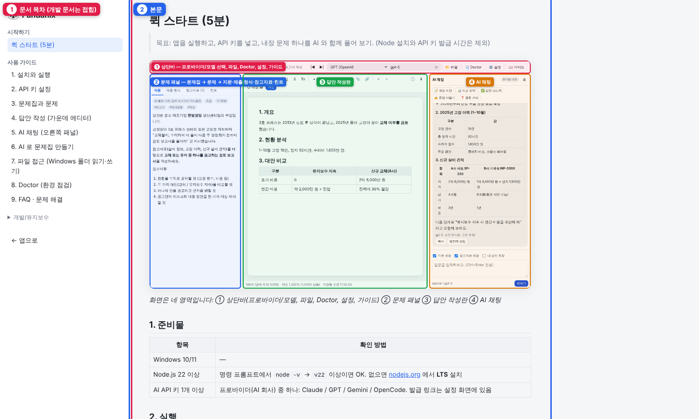

# 1. 설치와 실행

## 설치

1. [Node.js LTS](https://nodejs.org) 설치 (**22 이상**, 내부 AI SDK 요구사항). 설치 후 새 명령 프롬프트에서 `node -v` 로 확인
2. 프로젝트 폴더를 원하는 위치에 두기 (예: `C:\Pandanix`). 경로에 한글이 있어도 됩니다
3. `start.bat` 실행 → 처음 1회 `npm install` 자동 수행

수동 설치:
```bat
cd C:\Pandanix
npm install
npm start
```

## 실행 방법 비교

| 방법 | 언제 |
|---|---|
| `start.bat` | 평소. 브라우저 자동 열림 |
| `npm start` | 터미널에서 로그를 보며 실행 |
| `npm run dev` | 개발 중. 서버 파일이 바뀌면 자동 재시작 |

## 가이드 보기

상단바 **📖 가이드** 를 누르면 이 문서들을 앱 안에서 볼 수 있습니다. 오프라인용 HTML 은 `docs/html/index.html` 입니다.



## 종료

서버 창에서 `Ctrl+C` 또는 창 닫기. 작성 중인 답안은 자동 저장되어 있습니다.

## 포트 바꾸기

기본 포트는 `3210`. 바꾸려면 둘 중 하나:
- `data/config/settings.json` 의 `"port"` 수정
- 실행 시 환경변수: `set PORT=3300 && npm start`

## 데이터 폴더 위치 바꾸기

기본은 `<프로젝트>\data`. 다른 위치(예: OneDrive)에 두려면 환경변수 `PANDANIX_DATA_DIR` 지정:
```bat
set PANDANIX_DATA_DIR=D:\PandanixData
start.bat
```

## 업데이트

새 버전 파일로 덮어쓴 뒤 `npm install` 한 번. `data/` 폴더는 건드리지 않으므로 문제집·답안·키가 유지됩니다. 새로 추가된 내장 문제집은 자동 설치되지 않으니 왼쪽 **📚 내장 문제집** 에서 설치하세요.

## 백업

`data/` 폴더를 통째로 복사하면 끝입니다. (키 파일 `credentials.json` 포함 여부에 주의)
