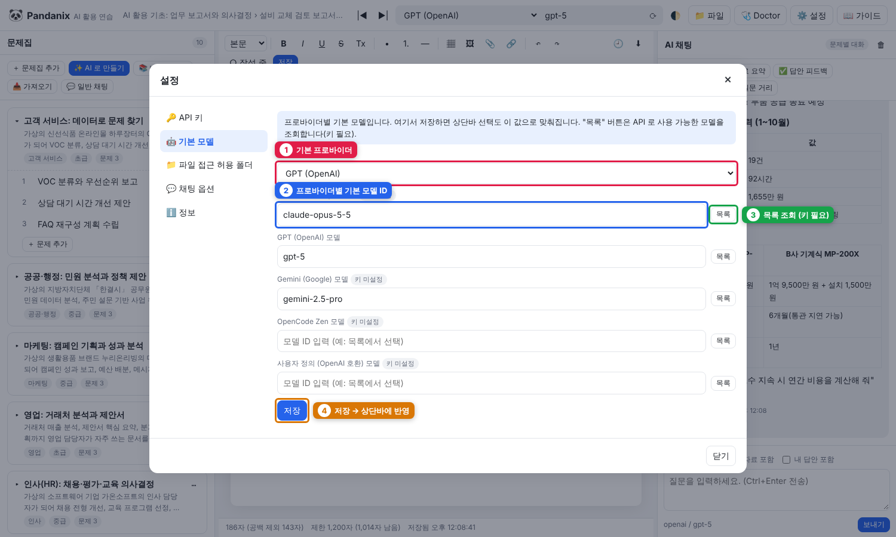

# 2. API 키 설정

AI 를 쓰려면 프로바이더(AI 회사) 중 **하나 이상**의 API 키가 필요합니다.

## 지원 프로바이더

| 프로바이더 | 키 발급 | 기본 모델 | 비고 |
|---|---|---|---|
| Claude (Anthropic) | [console.anthropic.com](https://console.anthropic.com/settings/keys) | `claude-opus-5-5` | 기본 프로바이더 |
| GPT (OpenAI) | [platform.openai.com](https://platform.openai.com/api-keys) | `gpt-5` | Base URL 비우면 공식 API |
| Gemini (Google) | [aistudio.google.com](https://aistudio.google.com/apikey) | `gemini-2.5-pro` | |
| OpenCode Zen | [opencode.ai/zen](https://opencode.ai/zen) | (⟳ 목록에서 선택, 필수) | OpenAI 호환, Base URL `https://opencode.ai/zen/v1`. 일부 모델은 chat/completions 를 지원하지 않을 수 있음 → 다른 모델 선택 |
| 사용자 정의 (OpenAI 호환) | — | (⟳ 목록에서 선택, 필수) | Ollama, LM Studio, vLLM 등 로컬 서버. 키 없어도 됨 |

## 설정 화면에서 입력 (권장)


*① 설정 메뉴 ② API 키 입력란 ③ 저장 ④ 연결 테스트 ⑤ 설정 상태 배지(키는 마스킹 표시)*

1. **⚙️ 설정 → 🔑 API 키**
2. 키 붙여넣기 → **저장**
3. **연결 테스트** → `✔ 연결 성공 · 모델 N개 조회됨` 이면 완료
4. **🤖 기본 모델** 탭에서 기본 프로바이더와 모델 지정 (**목록** 버튼으로 사용 가능한 모델 조회)


*① 기본 프로바이더 ② 프로바이더별 기본 모델 ID ③ 목록 조회 ④ 저장(상단바에도 반영)*

## 파일로 직접 입력

`data/config/credentials.json` (처음 실행 시 자동 생성):
```json
{
  "anthropic": { "apiKey": "sk-ant-..." },
  "openai":    { "apiKey": "sk-...", "baseUrl": "", "organization": "" },
  "gemini":    { "apiKey": "AIza..." },
  "opencode":  { "apiKey": "...", "baseUrl": "https://opencode.ai/zen/v1" },
  "custom":    { "apiKey": "", "baseUrl": "http://localhost:11434/v1" }
}
```
저장 후 새로고침하면 반영됩니다(서버 재시작 불필요).

## 환경변수로 입력

환경변수가 있으면 파일보다 **우선**합니다. 회사 PC 에서 키를 파일에 남기기 싫을 때 유용합니다.

| 프로바이더 | 환경변수 |
|---|---|
| Claude | `ANTHROPIC_API_KEY` |
| GPT | `OPENAI_API_KEY` |
| Gemini | `GEMINI_API_KEY` 또는 `GOOGLE_API_KEY` |
| OpenCode | `OPENCODE_API_KEY` |
| 사용자 정의 | `CUSTOM_API_KEY` |

## 상단바에서 모델 바꾸기


| 번호 | 항목 | 설명 |
|---|---|---|
| 1 | 패널 접기 | 왼쪽/오른쪽 패널 접기·펼치기 |
| 2 | 프로바이더 선택 | ⚠ (키 없음) 표시가 있으면 키를 먼저 입력 |
| 3 | 모델 ID | 직접 입력하거나 4번으로 선택 |
| 4 | ⟳ 모델 목록 | API 로 사용 가능한 모델을 불러와 고르기 |
| 5 | 🌓 테마 | 시스템 → 라이트 → 다크 순으로 전환 ([1장](01-설치와-실행.md#다크-모드)) |
| 6 | 📁 파일 | 파일 탐색기 ([7장](07-파일-탐색기.md)) |
| 7 | 🩺 Doctor | 환경 점검 ([8장](08-Doctor.md)) |
| 8 | ⚙️ 설정 | API 키·기본 모델·허용 폴더·채팅 옵션 |
| 9 | 📖 가이드 | 이 문서 |

상단바의 선택 상자에서 프로바이더를, 옆 입력란에서 모델 ID 를 바꿉니다. **⟳** 버튼으로 모델 목록을 불러와 고를 수 있습니다. 상단바 선택은 브라우저에 기억되며, 설정 화면의 기본 모델보다 **우선**합니다(설정값은 상단바에서 아직 고르지 않은 프로바이더의 초기값).

## 보안 메모

- `credentials.json` 은 `.gitignore` 에 들어 있어 커밋되지 않습니다 (Doctor 가 확인)
- UI 와 로그에는 키가 마스킹되어(`sk-a…1234`) 표시됩니다
- 키를 바꾸려면 새 값을 입력하고 저장, 지우려면 **키 삭제**
