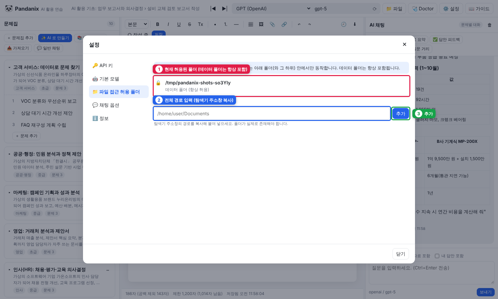
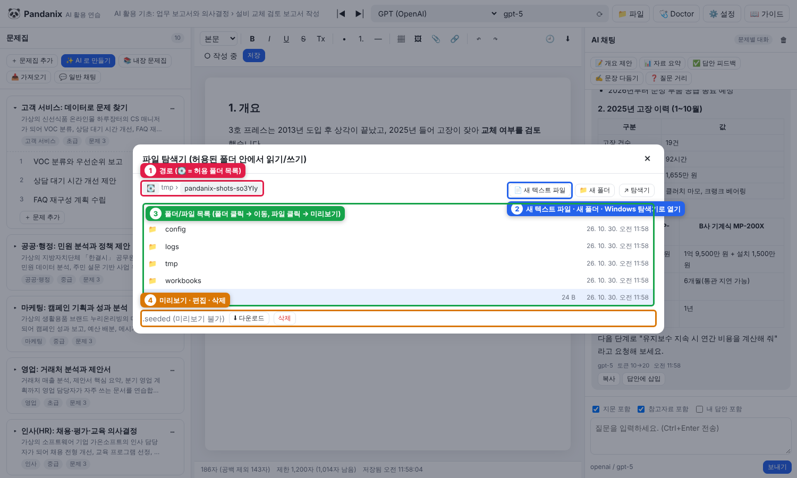

# 7. 파일 접근 (Windows 폴더 읽기·쓰기)

Pandanix 는 **허용한 폴더 안에서만** 로컬 파일을 다룹니다. 데이터 폴더(`data/`)는 항상 허용됩니다.

## 허용 폴더 추가

*① 현재 허용된 폴더 ② 전체 경로 입력 ③ 추가*

1. **⚙️ 설정 → 📁 파일 접근 허용 폴더**
2. 전체 경로 입력 (탐색기 주소창에서 복사) 예: `C:\Users\홍길동\Documents\업무자료`
3. **추가** → 목록에 표시되면 완료 (존재하지 않는 폴더는 거부됨)

> 하위 폴더는 자동으로 포함됩니다. `C:\` 전체를 추가하는 것은 권장하지 않습니다.

## 어디에서 쓰이나

| 기능 | 위치 |
|---|---|
| 📁 **파일** (상단바) | 파일 탐색기: 폴더 이동, 텍스트 미리보기·편집·저장, 새 파일/폴더 만들기, 삭제, Windows 탐색기로 열기 |
| 참고자료 → 📁 로컬 파일에서 | 로컬 파일을 문제의 참고자료로 **복사** |
| 에디터 → 내보내기 → 로컬 폴더에 저장 | 답안을 md/html 로 지정 폴더에 저장 |
| 문제집 ⋯ → 폴더로 내보내기 / 📥 가져오기 | 문제집 폴더 복사 |

## 파일 탐색기 화면

*① 경로(💽 = 허용 폴더 목록, 회색 조각은 허용 범위 밖) ② 새 텍스트 파일 · 새 폴더 · Windows 탐색기로 열기 ③ 목록 ④ 미리보기·편집·삭제*

- 상단 경로 조각(breadcrumb) 클릭으로 이동, 💽 로 허용 폴더 목록
- 텍스트 파일(md, txt, csv, json 등)은 클릭하면 미리보기 → **✏️ 편집 → 저장**
- **📄 새 텍스트 파일 / 📁 새 폴더** 로 생성, **삭제** 는 확인 후 영구 삭제
- **↗ 탐색기** 는 현재 폴더를 Windows 탐색기로 엽니다

## 제한

- 2MB 보다 큰 텍스트는 미리보기 불가(다운로드는 가능)
- 허용 폴더 밖 경로는 `403 허용되지 않은 경로` 로 거부됩니다. 이는 의도된 보호 동작입니다
