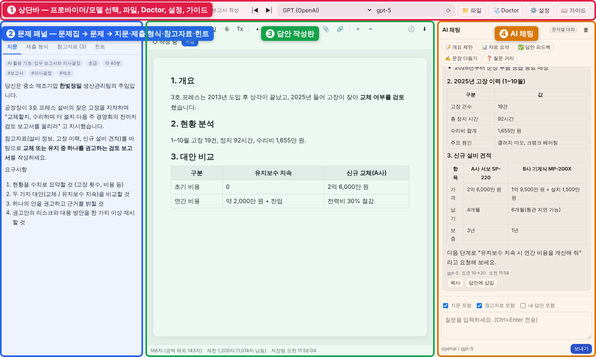
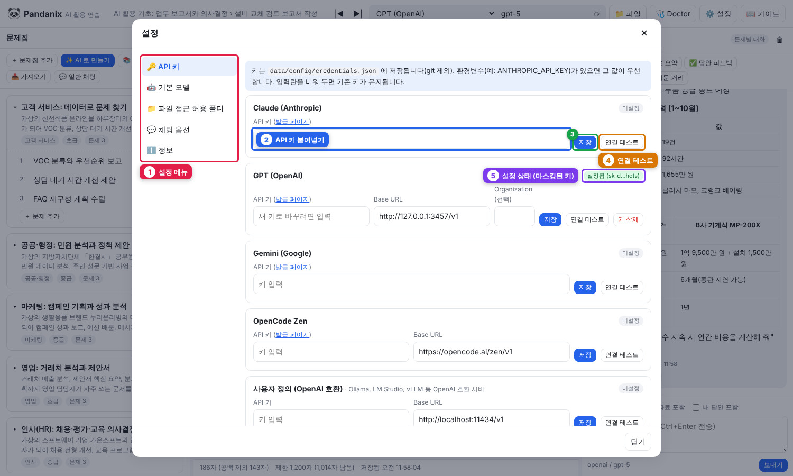
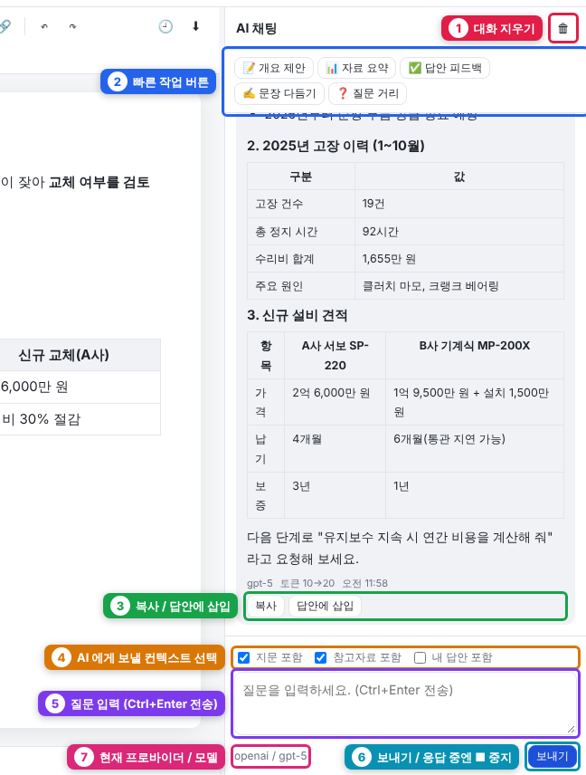

# 퀵 스타트 (5분)

> 목표: 앱을 실행하고, API 키를 넣고, 내장 문제 하나를 AI 와 함께 풀어 보기. (Node 설치와 API 키 발급 시간은 제외)

*화면은 네 영역입니다: ① 상단바(프로바이더/모델, 파일, Doctor, 설정, 가이드) ② 문제 패널 ③ 답안 작성란 ④ AI 채팅*

## 1. 준비물

| 항목 | 확인 방법 |
|---|---|
| Windows 10/11 | — |
| Node.js 22 이상 | 명령 프롬프트에서 `node -v` → `v22` 이상이면 OK. 없으면 [nodejs.org](https://nodejs.org) 에서 **LTS** 설치 |
| AI API 키 1개 이상 | 프로바이더(AI 회사) 중 하나: Claude / GPT / Gemini / OpenCode. 발급 링크는 설정 화면에 있음 |

## 2. 실행

1. 프로젝트 폴더에서 **`start.bat`** 더블클릭
2. 처음엔 자동으로 `npm install` 이 돌고(1~2분), 끝나면 브라우저가 열립니다
3. 안 열리면 직접 주소 입력: `http://localhost:3210`

> 검은 창(서버)은 닫지 마세요. 닫으면 앱이 종료됩니다.

## 3. API 키 입력

1. 오른쪽 위 **⚙️ 설정** → **🔑 API 키**
2. 사용할 프로바이더 칸에 키 붙여넣기 → **저장** → **연결 테스트** 로 ✔ 확인
3. 상단바의 프로바이더/모델 선택에서 방금 설정한 프로바이더 선택. OpenCode·사용자 정의는 기본 모델이 없으므로 **⟳ 버튼으로 목록을 불러와 모델을 꼭 고르세요**

*① 설정 메뉴 ② 키 입력 ③ 저장 ④ 연결 테스트 ⑤ 설정 상태*

키는 `data/config/credentials.json` 에만 저장되고 git 에는 올라가지 않습니다.

## 4. 첫 문제 풀기

1. 왼쪽 **문제집** 목록에서 `AI 활용 기초: 업무 보고서와 의사결정` 펼치기 → 1번 문제 클릭 (내장 문제집 10종이 미리 설치되어 있습니다)
2. 왼쪽 탭에서 **지문 → 제출 형식 → 참고자료** 순서로 읽기 (참고자료 이름을 클릭하면 미리보기)
3. 오른쪽 채팅에서 **📊 자료 요약** 버튼 클릭 → AI 가 참고자료를 요약
4. 답변 아래 **답안에 삽입** 을 누르면 가운데 에디터로 들어갑니다
5. 답안을 다듬고, **✅ 답안 피드백** 으로 평가 받기
6. 끝나면 에디터 상단 **○ 작성 중** 을 눌러 **✔ 완료** 로 표시

*② 빠른 작업 버튼으로 요약을 받고 ③ 답안에 삽입 으로 가운데 에디터에 넣습니다*

## 5. 문제가 생기면

- 🩺 **Doctor** 버튼 → 실패(❌) 항목의 안내대로 조치 → **다시 검사**
- 그래도 안 되면 [FAQ·문제 해결](guide/09-FAQ-문제해결.md)

## 다음 단계

- [AI 로 문제집 만들기](guide/06-AI로-문제집-만들기.md) — 우리 팀 업무에 맞는 문제집 자동 생성
- [파일 접근 설정](guide/07-파일-탐색기.md) — 내 문서 폴더의 자료를 참고자료로 쓰기
